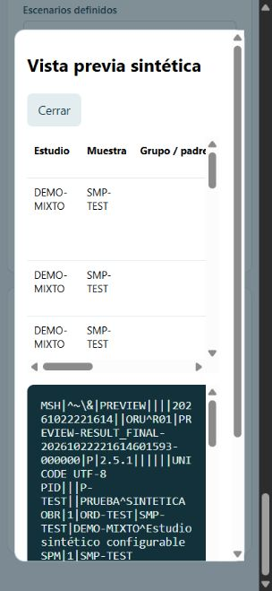

# Validación de resultados dinámicos — 22 de octubre de 2026

Esta evidencia corresponde a la nueva implementación. No sustituye ni altera
los informes históricos del repositorio, incluidos
[VALIDACION_REPOSITORIO_2026-10-15.md](VALIDACION_REPOSITORIO_2026-10-15.md),
`validacion_docker.json`, `resultado_validacion_hl7.json` y
`resultado_auditoria_simulador.json`.

Todas las pruebas nuevas utilizan datos sintéticos, SQLite temporal y peers TCP
locales. No envían resultados a hospitales, Mirth ni servicios externos.

## Criterios y evidencia

| Criterio | Evidencia ejecutada | Resultado |
| --- | --- | --- |
| Crear un estudio y parámetros nuevos desde UI | Editor real en navegador: DEMO-MIXTO con DEMO-NUM, DEMO-TEXTO y DEMO-CODIGO | Guardado como revisión 1 y vista previa visible |
| Flujo MLLP completo | `test_multistudy_mixed_types_two_isolates_real_mllp_and_stable_resend` usa listener real, orden fragmentada, receptor TCP que registra el ORU y devuelve ACK correlacionado | AA de entrada y salida; COMPLETED |
| Dos estudios en una orden | EXT-MIX y CULT, dos OBR con ORC y muestras distintos | 18 resultados y ambos OBR presentes en el HL7 recibido |
| Tipos mixtos | El receptor comprueba OBX-2 NM, TX, ST, CE y CWE, y componentes codificados | Correctos; caracteres de texto escapados |
| Dos microorganismos y sensibilidad | ORG1 y ORG2; dos antibióticos por aislamiento con concentración e interpretación | Relación por OBX-4 y parentGroupId, cuatro NTE recibidos |
| Agregar parámetro sin reiniciar | `test_new_parameter_new_order_without_restart_and_pinned_old_generation` agrega ADDED-LIVE, guarda/asocia v2 y recibe una orden nueva en el mismo motor | Parámetro nuevo presente; orden previa conserva su definición |
| Desconocidos y configuraciones inválidas | `test_unknown_policy_invalid_catalog_and_assignment_rollback` | BLOCK rechaza; TEMPLATE registra su uso; revisiones y asignaciones inválidas no reemplazan las válidas |
| Recuperación | Se recrea SimulationEngine sobre la misma SQLite | Catálogo, asignación, órdenes y valores idénticos; secuencias continúan |
| Reenvío sin sorteo | Dos envíos reales al mismo receptor | Filas OBX idénticas; generación no cambia |
| Regeneración explícita | Escenario NEGATIVE en orden procesada | Cuatro resultados, generación 2 e historial de los 18 resultados anteriores |
| Importación sin constantes clínicas | `test_import_only_suggests_structure_and_requires_generators` | Sin valores OBX-5 ni identificadores de paciente/orden; generadores requeridos |
| Mapeos por grupo y límites | `test_per_group_inbound_mapping_preserves_two_studies_and_specimens`, `test_oversized_orders_rejected_before_processing` | OML^O21/O33 conservan muestras; más de 2000 resultados rechaza antes de procesar |

## Ejecución automatizada

Suite completa en un contenedor temporal con la misma imagen del simulador:

```powershell
docker compose --env-file .env.example run --rm --no-deps `
  -v './services/analyzer-simulator-api/app:/app/app:ro' `
  -v './services/analyzer-simulator-api/tests:/app/tests:ro' `
  analyzer-simulator-api sh -c 'pip install -q httpx==0.28.1 && python -m unittest discover -s tests -v'
```

Resultado: 65 pruebas descubiertas, 64 correctas y una omitida porque la imagen
Python no incluye Node. Se ejecutó esa prueba por separado en Windows con Node:

```powershell
# Desde services/analyzer-simulator-api
python -m unittest discover -s tests -p test_editor.py -v
```

Resultado: una prueba correcta. Las 65 pruebas fueron ejecutadas satisfactoriamente
entre ambos entornos. También se verificó la sintaxis del JavaScript del catálogo,
del script inline de la interfaz y `git diff --check`.

## Comprobación visual

Se creó el catálogo **Demostración de resultados dinámicos** desde los formularios,
se agregaron tipos mixtos y el ejemplo de bacteriología, se guardó y se abrió su
vista previa. La tabla mostró estudios, parámetros, tipos, valores y relaciones;
el ORU mostró OBR por estudio, OBX con tipos configurados y notas NTE.
Después se agregó **DEMO-NUEVO** desde la interfaz integrada, se guardó la
revisión 2 y se verificaron sus 19 resultados sin reiniciar el servicio. Ambas
revisiones se recuperaron al recargar el editor.



Estos resultados verifican el contrato de integración implementado con los peers
locales de prueba. El catálogo inicial y el ejemplo bacteriológico contienen
valores declarados para pruebas; no son un catálogo clínico certificado.
