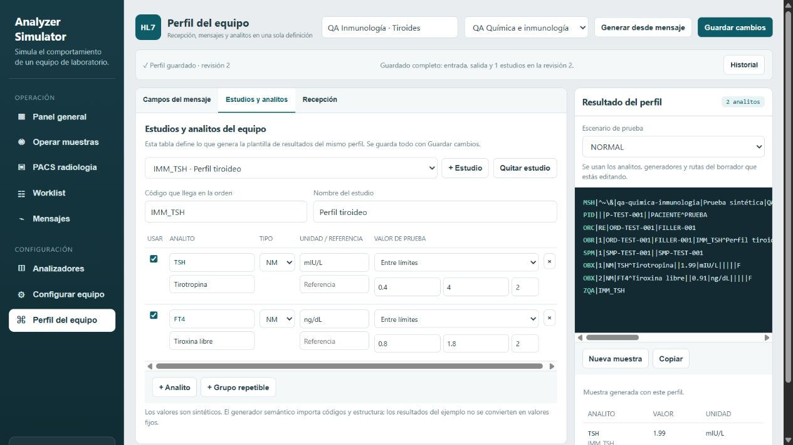

# Prueba de aceptación del configurador HL7

Fecha: 6 de noviembre de 2026. Instancia: http://localhost:8090.

**Resultado: PASA después de corregir un defecto de reenvío.** Se configuraron dos equipos y cuatro configuraciones completas desde la interfaz. La verificación final aprobó **60/60 comprobaciones** y la suite de regresión aprobó **128/128 pruebas**. Las capturas TCP coinciden con los mensajes registrados por el simulador.

La creación de equipos, importación de ejemplos, cambios de rutas, generadores, segmentos, guardado, restauración y operación de muestras se hicieron desde las pantallas. No se introdujeron perfiles mediante SQL, API de escritura, JSON avanzado ni cambios de código para configurar un equipo. Se utilizaron scripts como emisor y receptor externos MLLP y para consultar la evidencia. Durante el pase sí se encontró y corrigió un defecto interno, descrito al final.

## Equipos y perfiles que quedaron guardados

| Equipo | Identificador | Puerto de entrada | Configuraciones completas |
|---|---|---|---|
| QA Hematología | `qa-hematologia` | `5110` | QA Hematología · Hemograma; QA Hematología · Diferencial |
| QA Química e inmunología | `qa-quimica-inmunologia` | `5111` | QA Química · Básico; QA Inmunología · Tiroides |

Ambos usan HL7/MLLP, modo bidireccional, recepción permisiva y destino de resultados `127.0.0.1:5125` **dentro del contenedor**. Ese destino es el receptor sintético del pase.

**Funcionamiento actual de los perfiles:** cada equipo tiene una configuración activa. Las alternativas completas se conservan como revisiones con nombre en **Historial**. Para cambiar de alternativa se usa **Restaurar en el borrador → Guardar cambios**; esto crea una revisión nueva. No hay dos perfiles activos simultáneamente ni un selector independiente de familias de perfiles. Las restauraciones realizadas durante la prueba explican que existan más de dos revisiones por equipo.

Al terminar quedaron activos **Diferencial** y **Tiroides**. Hemograma y Básico están disponibles en el historial. Cada configuración contiene su entrada, salida, estudio y generadores juntos; no se asignó un catálogo separado.

| Perfil / código de estudio | Analitos | Generador elegido en la tabla |
|---|---|---|
| Hemograma / `HEM_CBC` | WBC, HGB | WBC: 4–10 `10*3/uL`; HGB: 12–17 `g/dL` |
| Diferencial / `HEM_DIFF` | NEUT, LYMP | NEUT: 40–70 `%`; LYMP: 20–45 `%` |
| Básico / `CHEM_BASIC` | GLU, CREA | GLU: 70–100 `mg/dL`; CREA: 0.6–1.2 `mg/dL` |
| Tiroides / `IMM_TSH` | TSH, FT4 | TSH: 0.4–4 `mIU/L`; FT4: 0.8–1.8 `ng/dL` |

Todos los analitos son NM, con generador **Entre límites** y dos decimales. Son rangos para esta simulación, no intervalos clínicos de referencia.

## Cómo hice la configuración desde la pantalla

1. Abrí **Configurar equipo → Nuevo**. Introduje el identificador, nombre, fabricante de prueba, perfil técnico `GENERIC`, protocolo HL7, modo **Bidireccional**, puerto de entrada y destino indicados arriba. Pulsé **Guardar**. Repetí con el segundo equipo.
2. Abrí **Perfil del equipo** y seleccioné el equipo. Esperé a que cargara su nombre y desapareciera «Cargando perfil» antes de editar.
3. Pulsé **Generar desde mensaje**. Elegí **Lo que recibe el equipo**, pegué el archivo `CODIGO-entrada.hl7`, pulsé **Analizar mensaje** y después **Aplicar al perfil**. Se detectaron ORM^O01, paciente, orden, estudio, muestra y el segmento adicional ZIN.
4. Repetí **Generar desde mensaje** con **Lo que envía el equipo** y `CODIGO-salida.hl7`. Se detectaron ORU^R01 y los dos analitos. Los valores del ejemplo no se adoptaron como generadores fijos: elegí explícitamente cómo generar cada resultado.
5. Escribí el nombre del perfil. En **Estudios y analitos** comprobé el código del estudio y las unidades, elegí **Entre límites** para ambos analitos y escribí los mínimos, máximos y decimales de la tabla anterior.
6. En **Campos del mensaje → Lo que recibe → ORC** cambié **Leer order.id** a `ORC-4.1`. Los ejemplos tienen deliberadamente otro identificador en ORC-2 y ORC-3 vacío. En las órdenes recibidas apareció `O-CODIGO`, tomado de ORC-4.1. En la salida se devolvió en ORC-2 y OBR-2. Esto se configuró desde el campo de ruta.
7. En **Campos del mensaje → Lo que envía → + Segmento** añadí `ZQA` en **Mensaje principal**. Seleccioné el segmento, pulsé **+ Campo** y escribí el código de su estudio como **Constante 1**, en `ZQA-1`. Cada perfil tiene su propia marca: `HEM_CBC`, `HEM_DIFF`, `CHEM_BASIC` o `IMM_TSH`.
8. En **Recepción** elegí **Permisiva · recibir HL7 sin exigir el contrato** y dejé marcada **Recibir estudios que aún no tienen analitos configurados**. La validación estricta quedó desmarcada.
9. Pulsé **Guardar cambios** una sola vez y comprobé «Perfil guardado». El guardado incluyó entrada, salida y catálogo del perfil.
10. Para preparar la segunda alternativa del mismo equipo conservando la primera, fui a **Estudios y analitos → Quitar estudio** en el borrador, importé sus nuevos ejemplos de entrada y salida, elegí sus nuevos generadores, ajusté otra vez `ORC-4.1`, añadí su `ZQA` y cambié el nombre. Guardé. La primera configuración siguió completa en **Historial**. Importar una salida reemplaza esa plantilla; por eso añadí ZQA después de importar cada una.

Se repitió este procedimiento para los cuatro perfiles. El generador semántico facilitó la base; las rutas y generadores se ajustaron con controles normales. No se abrió **Definición completa (avanzado)**.



## Recepción y envío reales

Para cada perfil, mientras estaba activo:

1. Envié `CODIGO-entrada.hl7` por MLLP al puerto de su equipo. Recibí **MSA|AA** con el mismo MSH-10.
2. En **Worklist** apareció la orden `O-CODIGO`, muestra `S-CODIGO`, paciente sintético y estudio correcto, en `WAITING_SAMPLE`.
3. Pulsé **Cargar**. Cuando pasó a `SAMPLE_LOADED`, pulsé **Procesar** y luego **Enviar informe** para Hemograma. Para los otros tres usé **Todo**, que procesa y envía. Esperé el estado final, porque la operación es asíncrona.
4. Comprobé `COMPLETED`, ACK `AA` y la captura del receptor MLLP. Cada ORU contiene solamente los dos analitos del perfil, sus valores generados y unidades, identificación de orden y su segmento ZQA.
5. Envié también `CODIGO-desconocido.hl7`. Los cuatro mensajes recibieron **AA** y crearon órdenes con `QA_DESCONOCIDO` pendiente de configurar. No hubo rechazo por estudio no soportado. Sus resultados quedaron vacíos hasta definir los analitos; recibir un código desconocido no basta para saber qué resultado generar.
6. Envié `ADT-entrada.hl7` a ambos equipos aunque su ejemplo de entrada era ORM. Ambos devolvieron **AA** y conservaron trazabilidad. Un ADT sin orden no necesita crear una muestra en la worklist.

Las órdenes conocidas se dejaron completadas. Las cuatro desconocidas quedaron visibles como pendientes de configuración para inspeccionar el comportamiento permisivo.

### Repetir la comunicación de prueba

Los ejemplos `.hl7` de esta carpeta contienen únicamente identificadores sintéticos. El emisor y receptor usan la biblioteca estándar de Python.

El receptor quedó ejecutándose durante este pase dentro del contenedor. Si se reconstruye o reinicia Docker, hay que iniciarlo de nuevo. Desde la raíz del repositorio, con el simulador levantado:

```powershell
$qaDir = 'docs/aceptacion_configurador_2026-11-06'
docker cp "$qaDir/mllp_qa.py" prueba-hl7-analyzer-simulator-api-1:/tmp/mllp_qa.py
docker exec -d prueba-hl7-analyzer-simulator-api-1 python -u /tmp/mllp_qa.py listen --port 5125 --folder /app/data/acceptance-mllp
```

Iniciarlo una sola vez por arranque. Si ya está escuchando, otro proceso no podrá usar el mismo puerto.

Para probar el perfil Diferencial que quedó activo:

```powershell
python "$qaDir/mllp_qa.py" send --port 5110 --file "$qaDir/HEM_DIFF-entrada.hl7"
```

Para Tiroides, usar puerto `5111` y `IMM_TSH-entrada.hl7`. Para Hemograma o Básico, primero restaurar su configuración desde **Historial**.

**Repetir exactamente el mismo MSH-10 y contenido es una retransmisión:** devuelve su ACK y no crea otra orden. Para obtener una orden nueva, copiar el ejemplo y cambiar MSH-10, identificadores de orden de ORC-2/ORC-4/OBR-2 y muestra SPM-2 a valores nuevos, manteniendo OBR-4 con el código del estudio. Si se cambia el contenido conservando MSH-10, existe un conflicto de identidad de mensaje, incluso en recepción permisiva.

También se pueden inspeccionar o reenviar desde **Worklist** las órdenes completadas de este pase. El reenvío conserva el perfil asociado a cada orden, aunque otra alternativa esté activa.

## Saltos de línea, restauración y persistencia

Se importaron desde la pantalla ejemplos con:

| Separador | Ejemplo usado | Resultado |
|---|---|---|
| CR real | Entradas y salidas originales | PASA |
| CRLF | Entrada Diferencial | PASA |
| LF | Entrada Básico | PASA |
| Texto literal `\r` | Salida Básico | PASA |
| Texto literal `/r` | Salida Hemograma | PASA |

En el transporte se enviaron tramas MLLP con segmentos terminados por CR real. La prueba de literales corresponde al pegado/importación en el configurador.

Restauré Hemograma y Diferencial desde el historial; también Básico y Tiroides. Cada restauración recuperó nombre, rutas, estudios y generadores y pudo guardarse sin editar JSON. Después se reconstruyó exclusivamente `analyzer-simulator-api`, manteniendo su volumen. Tras reconstruir:

- Los cuatro perfiles completos seguían guardados con sus estudios y generadores.
- Los perfiles existentes antes de reconstruir mantuvieron exactamente nombre, entrada, salida y catálogo.
- Los listeners arrancaron sin fallos.
- Los cuatro resultados pudieron reenviarse con ACK AA.
- Los dos analizadores, nueve órdenes, un catálogo y tres revisiones de perfiles que existían antes de esta prueba conservaron sus registros y configuración. Los equipos y órdenes QA son adiciones de este pase.

Respaldo previo del volumen: `/app/data/simulator.before-persistence-check-65cbe635.db`. Manifiesto de comparación: `/app/data/acceptance-before-20261106.json`.

## Evidencia y criterio de pase

| Comprobación | Resultado |
|---|---|
| Dos equipos creados desde formulario | PASA |
| Dos configuraciones completas por equipo en el historial | PASA; una activa por equipo |
| Base semántica desde ejemplos y edición posterior | PASA en las cuatro |
| Generadores, rutas y segmento ZQA sin código/JSON | PASA en las cuatro |
| Cuatro órdenes conocidas recibidas por MLLP | PASA, ACK AA |
| Cuatro órdenes desconocidas recibidas por MLLP | PASA, ACK AA y pendientes de resultados |
| ADT recibido con perfil basado en ORM | PASA en ambos equipos |
| Generación, correlación y salida ORU de cuatro perfiles | PASA, COMPLETED y ACK AA |
| Captura TCP idéntica a la salida registrada | PASA en las cuatro |
| Reenvío de orden anterior con otro perfil activo | PASA después de corrección |
| Persistencia tras reconstrucción Docker | PASA |
| Registros previos preservados | PASA |
| Verificador final de aceptación | 60/60 |
| Regresión automatizada | 128/128 |

Archivos de evidencia:

- `resultado-antes-reinicio.json`: estado inicial del pase; registra el defecto encontrado, **46/47** comprobaciones aprobadas en esa ejecución. Se conserva para no ocultar el resultado anterior.
- `resultado-despues-reinicio.json`: comprobación final **60/60**, definiciones completas de los perfiles y mensajes exclusivamente sintéticos.
- `capturas-receptor/`: mensajes recibidos mediante TCP por el peer externo al motor del simulador. Las capturas incluyen el intento inicial y los reenvíos posteriores.
- `evidencia-mllp/`: ACK recibidos al enviar los ejemplos de entrada. El archivo ADT se reutilizó en dos puertos; los dos ACK independientes también están en el registro final de mensajes.
- `01-hematologia-hemograma.png` a `05-historial-quimica.png`: capturas de la configuración realizada.
- `06-perfil-diferencial-final.png` y `07-historial-hematologia-final.png`: perfil e historial al terminar el pase, después del despliegue de la corrección.
- `datos-previos-preservados.json`: comparación aprobada de los registros anteriores.
- `verificar.py`: solo realiza consultas GET; contrasta perfiles, valores, códigos, unidades, correlación, segmentos, ACK y capturas TCP.
- `verificar_datos_previos.py`: compara los registros anteriores con el manifiesto del respaldo usando SQLite de lectura.

Para volver a ejecutar la validación final desde la raíz del repositorio:

```powershell
python docs/aceptacion_configurador_2026-11-06/verificar.py --output resultado-revalidado.json
```

### Defecto encontrado y corregido

En el primer intento el receptor sintético emitió `ACK` sin evento y el simulador lo rechazó. Se corrigió el peer para responder `ACK^R01` y se repitió el envío.

Después, la inspección de ZQA detectó un defecto del simulador: al cambiar el perfil activo y reenviar una orden antigua, sus valores seguían asociados al catálogo original, pero la plantilla se tomaba del perfil activo nuevo. Se corrigió la selección de salida para usar el perfil completo identificado por `catalogProfileId`, incluido cuando esa revisión fue retirada del historial. Las configuraciones antiguas siguen disponibles para las órdenes que ya las usan.

Se reforzó la prueba automatizada para comprobar plantilla, valores e identificador de perfil, tanto después de activar otra configuración como después de retirar la anterior. Las 128 pruebas pasaron. Se desplegó la corrección en Docker y los cuatro reenvíos reales pasaron la validación final. No quedó un fallo de aceptación abierto dentro de los casos probados.

El pase cubre los mensajes y variantes indicados. La recepción permisiva evita rechazos por el contrato o por códigos de estudios; la comunicación sigue necesitando una trama MLLP y una cabecera HL7 identificable. Para devolver resultados se requieren analitos y generadores definidos, y un receptor de resultados disponible.
